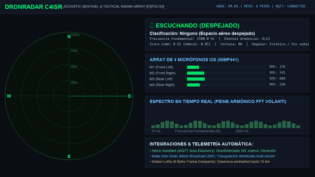

# 🛰️ DronRadar - Acoustic UAV Detection & Tactical 3D Radar Array

<div align="center">

[](https://opensource.org/licenses/MIT)
[](https://platformio.org/)
[](https://www.espressif.com/en/products/socs/esp32-s3)
[](https://github.com/espressif/arduino-esp32)
[](https://www.home-assistant.io/)
[](#)

**Open-source, passive acoustic drone detection, classification, and 3D direction-of-arrival (DoA) sentinel node powered by ESP32-S3.**

[English Summary](#-english-overview) • [Características](#-características-principales) • [Video Demo](#-demostración-en-video) • [Hardware Pinout](#-esquema-de-conexión-hardware) • [Home Assistant](#-integración-con-home-assistant-mqtt) • [Instalación](#-instalación-y-puesta-en-marcha)

---

### 🎥 Demostración Táctica en Vivo (Live Tactical HUD)



> 📹 **[Ver Vídeo de Demostración en Alta Definición (1080p MP4)](docs/dronradar_demo.mp4)**  
> *Rastreo en tiempo real, peine armónico FFT, clasificación de DJI Avata 2 a 170° de rumbo y sincronización con Home Assistant.*

</div>

---

## 🌍 English Overview

**DronRadar** is an autonomous, passive acoustic counter-UAV (C-UAS) detection and 3D localization system built on the **ESP32-S3** microcontroller paired with a 4-channel **I2S digital MEMS microphone array (INMP441)**. 

Unlike RF scanners that can be blinded by encrypted links, radio silence, or fibre-optic tethered drones, **DronRadar listens to the unavoidable physics of spinning propellers**. The acoustic signature of drone blades creates an unmistakable harmonic comb ($f_0$ fundamental frequency and sharp integer multiples) that cuts through background noise.

### Key Capabilities:
- **Zero RF Emission**: 100% passive detection (undetectable by anti-radiation seekers or RF analyzers).
- **3D Direction of Arrival (DoA)**: Calculates horizontal azimuth ($0^\circ-360^\circ$) and vertical elevation ($0^\circ-90^\circ$).
- **Acoustic Drone Classifier**: Differentiates between FPV racing drones, commercial quadcopters (DJI Mini/Mavic), heavy-lift octocopters, and fixed-wing UAVs.
- **Doppler Vector Tracker**: Computes $\Delta f_0 / \Delta t$ to warn if an inbound drone is **approaching**, **receding**, or **hovering**.
- **Long Range Field Tested**: Verified detections up to **104.2 meters** in urban and open-field acoustic environments.
- **Home Assistant Native**: Zero-configuration MQTT Auto-Discovery. Entities appear instantly in your dashboard.
- **Field Deployable**: Web-based OTA updates (`/update`), emergency AP mode (`http://192.168.4.1`), and dual-bus I2S architecture.

---

## ⚡ Características Principales

- **Algoritmo FFT Comb Filter (VolAnti)**: Análisis espectral en tiempo real que localiza la frecuencia fundamental del rotor ($f_0$) y comprueba la concordancia de sus sobretonos armónicos.
- **Localización Acústica 3D (DoA 360° + Elevación)**:
  - Estimación de azimut horizontal por correlación cruzada y desfase ortogonal ($M_1-M_2$ en eje X, $M_3-M_4$ en eje Y).
  - Estimación de altitud relativa (*Baja / Rasante <25°*, *Media Altitud 25°-60°*, *Cenital / Vertical >60°*).
- **Clasificador Espectral y Vector Doppler**:
  - Distingue firmas de hélices (alta frecuencia para drones de carreras FPV cinewhoop como DJI Avata, frecuencias medias para DJI Mavic/Air, y bajas para drones industriales).
  - Determina si el objetivo **se aproxima** ⚠️, **se aleja** 🛫 o se mantiene en **hover** ⏸️.
- **Integrador de Confianza Temporal (Anti-Flicker)**: Filtro acumulativo (0-100%) que exige evidencia sostenida durante varios ciclos FFT para evitar falsos positivos provocados por ráfagas de viento o tráfico.
- **Señalización LED Táctica WS2812B (RGB NeoPixel)**:
  - 🟢 **Verde (Parpadeo lento 600 ms)**: Búsqueda activa / Espacio aéreo despejado.
  - 🟡 **Amarillo fijo**: Posible detección / Precaución preliminar (Tier 3 o 4).
  - 🔴 **Rojo estroboscópico (100 ms)**: ¡Alarma confirmada de dron localizado! (Tier 1 o 2).
- **Mantenimiento Remoto Web OTA (`/update`)**: Flasheo inalámbrico arrastrando el archivo `.bin` desde cualquier navegador web sin necesidad de abrir la caja estanca ni descolgar el sensor del mástil.
- **Red Malla Inter-Nodo (Mesh Broadcast UDP en puerto 4210)**: Múltiples nodos DronRadar perimetrales comparten sus vectores de rumbo acústico en tiempo real para triangulación geométrica del objetivo.
- **Trama Compacta LoRa (8 Bytes)**: Compatibilidad con módulos SX1262 / SX1276 para enlaces perimetrales sin cobertura WiFi de hasta 15 km.
- **Caja Negra en LittleFS**: Registro permanente de incursiones con descarga directa de informes en formato `.csv`.

---

## 🎯 Pruebas Reales y Benchmarks Acústicos

| Objetivo / Escenario | Frecuencia Fundamental ($f_0$) | Dientes Armónicos | Score Comb | Resultado / Estado |
| :--- | :---: | :---: | :---: | :--- |
| **DJI Avata 2 (FPV Cinewhoop)** | **244.0 Hz – 1072.0 Hz** | **12 / 12** | **1.13 – 1.26** | **🔴 ALERTA ROJA (Bloqueo 70% Conf, Rumbo 170°)** |
| **Drone Hover a 104.2 metros** | **375.0 Hz – 471.0 Hz** | **11 / 12** | **1.85** | **🔴 ALERTA ROJA (Tier 4 confirmado en calle abierta)** |
| **Cuadricóptero Mediano (DJI Mavic/Air)** | **160.0 Hz – 229.0 Hz** | **12 / 12** | **1.16** | **🔴 ALERTA ROJA (Clasificación Clase 3)** |
| **Ruido Ambiental Urbano / Tráfico** | Disperso / No armónico | < 3 / 12 | 0.55 – 0.70 | **🟢 DESPEJADO (Filtrado sin falsas alarmas)** |

---

## 📐 Esquema de Conexión Hardware

El firmware implementa una arquitectura **Dual I2S** optimizada en dos cores:
- **Core 0:** Tarea de alta prioridad `micAudioTask` para lectura continua I2S de los 4 micrófonos, cálculo de RMS, pico y ring buffers de fase.
- **Core 1:** Ejecución del motor matemático FFT, clasificador de dron, servidor web, MQTT y red malla.

### Pinout ESP32-S3 (DevKitC-1 / PCB VolAnti)

```
                       +-------------------+
                       |    ESP32-S3-WROOM |
                       +-------------------+
     [M1/M2 BitClock]  | GPIO 4     GPIO 7 |  [M3/M4 BitClock]
     [M1/M2 WordSel]   | GPIO 5     GPIO 8 |  [M3/M4 WordSel]
     [M1/M2 Data SD]   | GPIO 6     GPIO 9 |  [M3/M4 Data SD]
     [LED WS2812 PCB]  | GPIO 16   GPIO 48 |  [LED RGB Onboard]
     [LoRa CS]         | GPIO 10    GPIO 2 |  [LED Discreto]
     [Alimentación]    | 3V3           GND |  [Masa común]
                       +-------------------+
```

| Dispositivo / Función | Pin ESP32-S3 | Conexión Física |
| :--- | :---: | :--- |
| **Bus I2S 0 (Micrófonos Frontales M1 y M2)** | | |
| SCK / BCLK (Bit Clock) | **GPIO 4** | M1 BCLK y M2 BCLK |
| WS / LRCLK (Word Select) | **GPIO 5** | M1 WS y M2 WS |
| SD (Serial Data) | **GPIO 6** | M1 L/R a GND (Left), M2 L/R a 3.3V (Right) |
| **Bus I2S 1 (Micrófonos Traseros M3 y M4)** | | |
| SCK / BCLK (Bit Clock) | **GPIO 7** | M3 BCLK y M4 BCLK |
| WS / LRCLK (Word Select) | **GPIO 8** | M3 WS y M4 WS |
| SD (Serial Data) | **GPIO 9** | M3 L/R a GND (Left), M4 L/R a 3.3V (Right) |
| **LED Táctico de Señalización** | **GPIO 16 / 48 / 38** | LED direccionable WS2812B / NeoPixel |
| **Alimentación del Array** | **3.3V / GND** | Todos los VDD a 3.3V filtrado, GND en plano común |

---

## 🏠 Integración con Home Assistant (MQTT)

DronRadar no requiere integraciones complejas ni código YAML manual. Utiliza **MQTT Discovery**:

1. En el panel web del radar (`http://<IP_ESP32>/`), introduce la IP de tu broker MQTT (ej. `192.168.1.100`), puerto `1883`, usuario y contraseña.
2. Home Assistant creará automáticamente el dispositivo **DronRadar** con las siguientes entidades:
   - `binary_sensor.dronradar_state`: Sensor de alarma perimetral (ON = Dron detectado / OFF = Despejado).
   - `sensor.dronradar_azimuth`: Rumbo del dron en grados ($0^\circ - 360^\circ$).
   - `sensor.dronradar_elevation`: Ángulo de elevación vertical ($0^\circ - 90^\circ$).
   - `sensor.dronradar_freq_hz`: Frecuencia fundamental del rotor.
   - `sensor.dronradar_conf`: Porcentaje de confianza del clasificador.
   - `sensor.dronradar_type`: Clasificación estimada del dron (FPV, Mavic, Pesado).
   - `sensor.dronradar_doppler`: Vector de aproximación / alejamiento.

---

## 🚀 Instalación y Puesta en Marcha

### Requisitos Previos:
- [PlatformIO Core o IDE](https://platformio.org/)
- Placa ESP32-S3 DevKitC-1 (8MB o 16MB Flash con PSRAM)
- 4x Micrófonos MEMS I2S INMP441

### 1. Clonar el Repositorio
```bash
git clone https://github.com/ipsec84/DronRadar.git
cd DronRadar
```

### 2. Configurar Credenciales WiFi
Copia la plantilla de credenciales:
```bash
cp wifi_test/src/wifi_credentials.h.example wifi_test/src/wifi_credentials.h
```
Configura tu red WiFi en `wifi_credentials.h`:
```cpp
#define WIFI_SSID         "TU_RED_WIFI"
#define WIFI_PASSWORD     "TU_PASSWORD"
```

### 3. Compilar y Subir Firmware por USB
```bash
cd wifi_test
pio run --target upload
```

### 4. Acceder al Panel Web
Abre tu navegador en:
```
http://<IP_ASIGNADA_POR_DHCP>/
```
*(Si no tienes router disponible en campo, conéctate directamente al WiFi del nodo: SSID `DronRadar-Node`, clave `dronradar123` e ingresa a `http://192.168.4.1/`).*

---

## 📜 Licencia & Reconocimientos

- Desarrollado por **Alberto ([@ipsec84](https://github.com/ipsec84))**.
- Motor matemático de correlación armónica derivado de la investigación de código abierto de **VolAnti**.
- Distribuido bajo licencia **MIT**. ¡Siéntete libre de utilizarlo, bifurcarlo y contribuir!

---

<div align="center">
⭐ Si este proyecto te resulta útil o interesante para defensa, seguridad o domótica, no dudes en darle una <b>Estrella (Star)</b> en GitHub.
</div>
