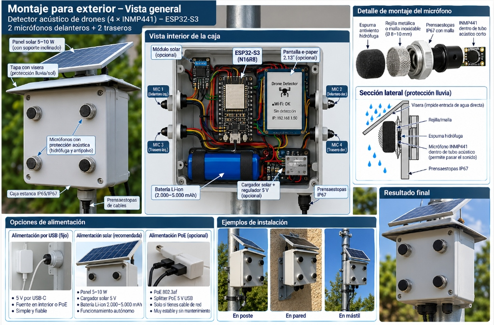
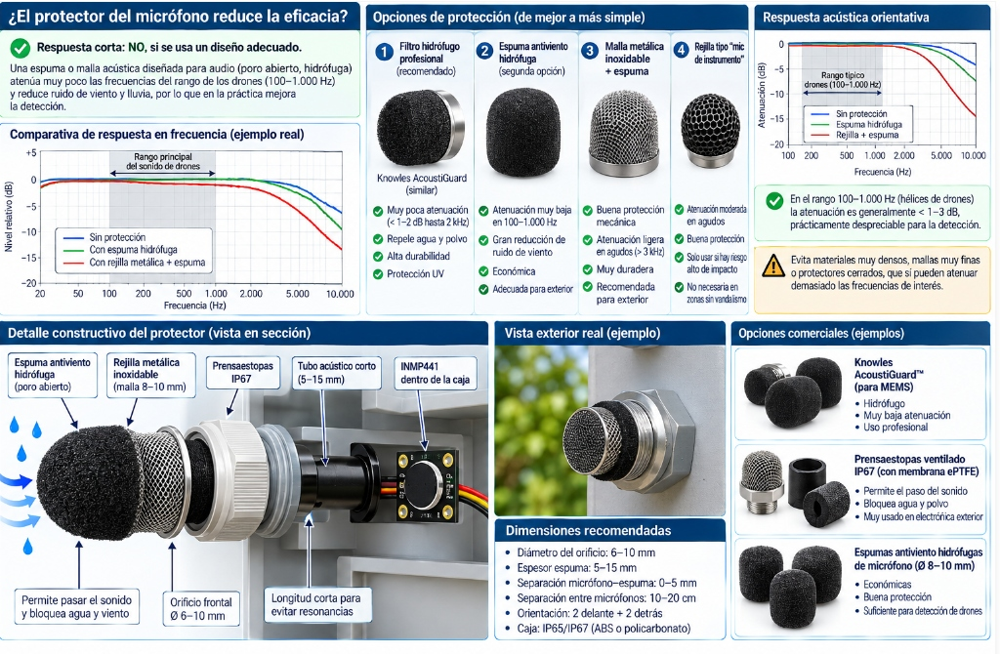

# 🛰️ DronRadar - Detector Acústico de Drones (ESP32-S3 + VolAnti)

**DronRadar** es un sistema autónomo de detección acústica, clasificación y localización angular en 360° (DoA) de vehículos aéreos no tripulados (UAV / Drones) basado en el microcontrolador **ESP32-S3** con matriz de **4 micrófonos I2S (INMP441)** y el algoritmo de filtro en peine FFT de **VolAnti**.

El sistema funciona de forma 100% local, embebida y en tiempo real, ofreciendo una interfaz Web militar tipo HUD (Radar PPI + Espectrograma en Cascada), caja negra de incursiones persistente en LittleFS, integración con Home Assistant (MQTT) y sincronización de hora local sin requerir conexión a Internet.

---

## ⚡ Características Principales

- **Algoritmo FFT Comb Filter (VolAnti)**: Detección armónica de frecuencia fundamental ($f_0$) y sobretonos de palas de rotor en rangos de 100 Hz a 1000 Hz.
- **Integrador de Confianza Temporal (Anti-Flicker)**: Filtro de persistencia temporal (0-100%) que acumula evidencia acústica continua, discriminando ráfagas transitorias de viento, tráfico o aves, y estabilizando el nivel de alerta (Tier 1 a 4).
- **Radar Acústico DoA 360° (Direction of Arrival)**: Estimación de azimut mediante diferencias de fase entre pares ortogonales de micrófonos ($M_1-M_2$ en eje X, $M_3-M_4$ en eje Y).
- **Espectrograma en Cascada (Live Waterfall)**: Cascada de frecuencia en tiempo real (48 bins, canvas HTML5) que visualiza la firma acústica del dron.
- **Caja Negra en LittleFS & Exportación CSV**: Registro histórico de incursiones con fecha, hora, azimut, frecuencia, umbral y duración persistido en memoria flash interna. Botón de descarga directa `informe_incursiones.csv`.
- **Sincronización Horaria Local**: API `/api/set_time` que sincroniza el reloj interno del ESP32 con la hora del navegador cliente al conectarse, además de comando serie `T HH:MM:SS`.
- **Seguimiento Dinámico del Suelo de Ruido (Auto Noise Floor)**: Umbral adaptativo calibrado automáticamente según el entorno acústico exterior.
- **Integración IoT / Home Assistant**: Publicación de telemetría, eventos de intrusión y métricas por MQTT compatible con Home Assistant.

---

## 📐 Esquema de Conexión Hardware

El firmware utiliza **dos buses I2S independientes** en el ESP32-S3 para capturar 4 canales de audio simultáneos a 16 kHz:



### Pinout ESP32-S3 DevKitC-1 N16R8

| Dispositivo / Función | Pin ESP32-S3 | Conexión / Detalle |
| :--- | :--- | :--- |
| **Bus I2S 0 (Micrófonos M1 y M2)** | | |
| SCK / BCLK (Bit Clock) | **GPIO 4** | M1 BCLK & M2 BCLK |
| WS / LRCLK (Word Select) | **GPIO 5** | M1 WS & M2 WS |
| SD (Serial Data) | **GPIO 6** | M1 L/R a GND (Left), M2 L/R a 3V3 (Right) |
| **Bus I2S 1 (Micrófonos M3 y M4)** | | |
| SCK / BCLK (Bit Clock) | **GPIO 7** | M3 BCLK & M4 BCLK |
| WS / LRCLK (Word Select) | **GPIO 8** | M3 WS & M4 WS |
| SD (Serial Data) | **GPIO 9** | M3 L/R a GND (Left), M4 L/R a 3V3 (Right) |
| **Alimentación Micrófonos** | **3.3V / GND** | Todos los VDD a 3.3V, todos los GND compartidos |
| **LED RGB Direccionable** | **GPIO 16 / 48** | Indicador de estado de alerta |
| **Pantalla e-Paper (Opcional)** | SPI | Waveshare 2.13" para estado autónomo |

---

## 🌧️ Protección de Micrófonos para Intemperie (IP65 / IP67)

Para instalaciones exteriores (mástiles, tejados, perímetros), los sensores acústicos INMP441 requieren protección contra lluvia, humedad y viento minimizando la atenuación de frecuencias:



### Recomendaciones de Fabricación:
1. **Prensaestopas IP67 con cavidad acústica**: Orificio exterior de 6–10 mm con orientación inclinada o hacia abajo para evitar acumulación de agua.
2. **Membrana hidrofóbica permeable al sonido**: Malla acústica tipo *Knowles AcoustiGuard* o membrana ePTFE permeable al aire pero impermeable al agua.
3. **Filtro de espuma de celda abierta**: Protección contra ruido de viento superficial.
4. **Respuesta en frecuencia**: Atenuación inferior a 1–3 dB en la banda crítica del dron (100 Hz – 1000 Hz).

---

## 🚀 Instalación y Puesta en Marcha

### Requisitos
- [PlatformIO](https://platformio.org/) (en VS Code o CLI)
- ESP32-S3 DevKitC-1 (N16R8 recomendado)
- 4x Micrófonos MEMS I2S INMP441

### 1. Clonar el repositorio
```bash
git clone https://github.com/ipsec84/DronRadar.git
cd DronRadar
```

### 2. Configurar Credenciales
Copia la plantilla de credenciales en `wifi_test/src/`:
```bash
cp wifi_test/src/wifi_credentials.h.example wifi_test/src/wifi_credentials.h
```
Edita `wifi_credentials.h` con tu SSID WiFi y contraseña.

### 3. Compilar y Subir Firmware
```bash
cd wifi_test
pio run --target upload
```

### 4. Acceder al Panel de Control Web
Abre tu navegador en la IP asignada al ESP32 (visible en el monitor serie a 115200 baudios):
```
http://<IP_DEL_ESP32>/
```
El panel sincronizará automáticamente la hora de tu navegador con el reloj del radar.

---

## 🛠️ Herramientas de Monitorización

En la carpeta raíz se incluyen scripts de soporte para depuración y calibración vía puerto serie:
- `monitor_com6.py`: Monitor en tiempo real de métricas FFT, RMS por micrófono y estados de alerta.
- `test_com6.py`: Verificación rápida de comunicación serie con el microcontrolador.

---

## 📜 Licencia y Agradecimientos

- Motor de detección armónica basado en la investigación abierta de **VolAnti**.
- Licencia MIT.
